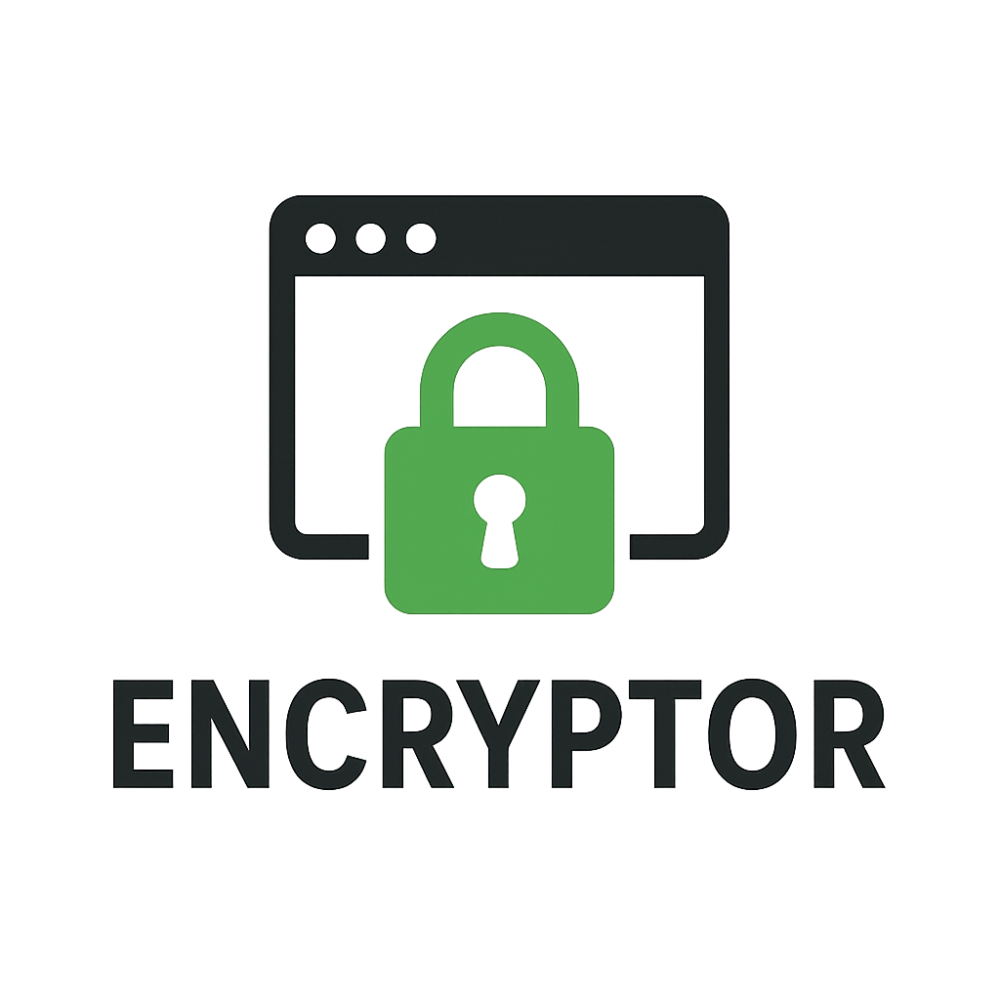

<div align="center">



# Encryptor

[](https://github.com/mpgamer75/encryptor/actions/workflows/test.yml)
[](https://opensource.org/licenses/MIT)
[](https://www.gnu.org/software/bash/)
[](https://github.com/mpgamer75/encryptor/releases)

**Authenticated file encryption and X.509 toolkit — nothing but Bash and OpenSSL**

*Encrypt with a password or for certificate holders. Interactive terminal UI for people, a strict CLI for scripts.*

</div>

---

## Why Encryptor

- **Authenticated by construction.** Every file is a self-describing `ENCRYPTOR/3` container: cipher + HMAC-SHA256 (encrypt-then-MAC). A wrong password or a single flipped bit is detected *before* any plaintext is written.
- **X.509 recipients.** Encrypt for one or more people using the certificates your organisation already issues (RSA or EC). No shared password.
- **No new dependencies, nothing to trust but OpenSSL.** About 4,000 lines of readable Bash on top of the `openssl` binary already on your servers. Works on air-gapped and locked-down hosts.
- **Recoverable without this tool.** The format is documented and every file can be decrypted with stock `openssl` commands ([docs/FORMAT.md](docs/FORMAT.md)).
- **Built for automation.** Sub-commands, `--json`, stable exit codes, stdin/stdout, secrets from files/env/stdin — never from arguments.
- **Memory-hard password protection.** scrypt by default — run by stock OpenSSL with the password delivered through a pipe; PBKDF2 on request for NIST-only policies.
- **Secrets stay off the disk and out of `ps`.** Passwords and keys reach OpenSSL through anonymous pipes.
- **A small PKI and an audit included.** Identities, root CA, signing profiles with SANs, PKCS#12, expiry monitoring, and a self-test with known-answer vectors.

## Install

```bash
curl -fsSL https://raw.githubusercontent.com/mpgamer75/encryptor/main/install.sh | bash
```

Installs to `~/.local` (or `/usr/local` when run as root); set `PREFIX` to choose. For a reproducible install, pin a release and its checksum:

```bash
curl -fsSL https://raw.githubusercontent.com/mpgamer75/encryptor/v3.0.0/install.sh \
  | ENCRYPTOR_REF=v3.0.0 ENCRYPTOR_SHA256=<sha256 from the release page> bash
```

Other options:

| Method | Command |
|---|---|
| From a checkout | `git clone https://github.com/mpgamer75/encryptor && cd encryptor && ./install.sh` |
| Debian / Ubuntu package | `./build_deb.sh && sudo apt install ./encryptor_3.0.0-1_all.deb` |
| Docker | `docker build -t encryptor . && docker run --rm -it -v "$PWD:/data" encryptor` |
| No install | `./encryptor.sh` from the repository |

**Requirements:** Bash 4.4+, OpenSSL 1.1.1+ (3.x recommended), coreutils. macOS: `brew install bash openssl@3`.

Uninstall with `./uninstall.sh` (your keys in `~/.config/encryptor` are kept unless you confirm).

## Quick start

```bash
encryptor                                   # interactive UI

encryptor encrypt report.pdf                # → report.pdf.enc (prompts for a password)
encryptor decrypt report.pdf.enc            # → report.pdf
encryptor inspect report.pdf.enc            # what is this file? (no password needed)
encryptor verify -p pass.txt report.pdf.enc # is it intact, is my password right?
```

### Interactive UI

```
      ______                             __
     / ____/___  ____________  ______  / /_____  _____
    / __/ / __ \/ ___/ ___/ / / / __ \/ __/ __ \/ ___/
   / /___/ / / / /__/ /  / /_/ / /_/ / /_/ /_/ / /
  /_____/_/ /_/\___/_/   \__, / .___/\__/\____/_/
                        /____/_/
  Authenticated file encryption · X.509 toolkit      v3.0.0
 ──────────────────────────────────────────────────────────────
  ● OpenSSL 3.0.13   ● AES-256-CTR + HMAC-SHA256   ● scrypt
  ● 3 certificate(s) · 2 key(s)   ▲ 1 expiring soon   ● ~/projects
 ──────────────────────────────────────────────────────────────

  Main menu

 ❯ e Encrypt a file       password or certificate recipients
   d Decrypt a file       format is detected automatically
   i Inspect & verify     read metadata, check integrity without decrypting

   c Certificates & keys  identities, CA, signing, PKCS#12
   a Security audit       self-test, permissions, expiry, TLS scan

   l Activity log
   h Help
   q Quit

  ↑/↓ move · Enter select · q back
```

Arrow keys or `j`/`k` to move, letters as shortcuts, type-to-filter in the file browser, `Esc`/`q` to go back. Colors follow [`NO_COLOR`](https://no-color.org); the UI falls back to ASCII in non-UTF-8 locales.

### Scripting

```bash
# Password from a file, JSON result, non-zero exit on any failure
encryptor encrypt --pass-file /run/secrets/backup.pass --json db.sql
# {"status":"success","operation":"encrypt","input":"db.sql","output":"db.sql.enc",...}

# Directories and streams
tar cz project/ | encryptor encrypt -p pass.txt -o project.tgz.enc -
encryptor decrypt -p pass.txt -o - project.tgz.enc | tar xz

# Encrypt for people, not passwords
encryptor encrypt -r alice.pem -r bob.pem contract.docx
encryptor decrypt -k ~/.config/encryptor/certs/alice.key contract.docx.enc

# Monitoring
encryptor certs --json --warn-days 45      # exit 1 if a certificate expires soon
encryptor audit --json                     # exit 1 if a security check fails
```

Exit codes: `0` ok · `1` failure · `2` usage · `3` wrong password/key or failed authentication · `4` input missing · `5` output exists · `6` unsupported format.

Full reference: [docs/USAGE.md](docs/USAGE.md) · `encryptor help` · `man encryptor`.

## How it protects your files

| | |
|---|---|
| Container | `ENCRYPTOR/3`: text header (mode, cipher, KDF parameters) + ciphertext + 256-bit tag |
| Integrity | HMAC-SHA256 over header and ciphertext, verified before decryption (encrypt-then-MAC) |
| Ciphers | AES-256-CTR (default), ChaCha20, AES-256-CBC, Camellia-256-CBC, ARIA-256-CBC |
| Password KDF | **scrypt** (N=2^14, r=8, p=5 — memory-hard, an OWASP-listed configuration) sealing a random file key; or PBKDF2-HMAC-SHA256, 600,000 iterations with `--kdf pbkdf2` |
| Recipients | Random 256-bit file key wrapped per certificate with CMS (RSA-OAEP-SHA256 or ECDH) |
| Secret handling | `-pass fd:N` pipes; never argv, never temp files; private temp dir (`mktemp`, 0700) |
| Files created | Mode 0600 (`umask 077`); private keys 0400; state directory 0700 |

Details and rationale: [docs/ALGORITHMS.md](docs/ALGORITHMS.md). Byte-level specification and the openssl-only recovery recipe: [docs/FORMAT.md](docs/FORMAT.md). Threat model and limitations: [SECURITY.md](SECURITY.md).

## Certificates

`encryptor` → **Certificates & keys**, or use the files in `~/.config/encryptor/certs/` directly.

| Task | What you get |
|---|---|
| Quick identity | Key + self-signed certificate, ready to receive encrypted files |
| Import a recipient | Add someone's `.pem` after checking its fingerprint |
| Root CA / CSR / sign | ECDSA P-256/P-384 or RSA 3072/4096; profiles *identity*, *server* (SAN required), *client*; correct `basicConstraints`, `keyUsage`, `extendedKeyUsage` |
| Dashboard | Every certificate with days to expiry, key type, and key-file protection |
| Check | Does this key belong to this certificate? Does the chain verify? |
| PKCS#12 export | AES-256 + PBKDF2 + SHA-256 MAC (not the legacy RC2/3DES defaults) |

Private keys can be passphrase-protected (AES-256) and are always created with mode 0400.

## How it compares

Encryptor is not a replacement for [age](https://age-encryption.org) or GnuPG; it covers a different niche.

| | Encryptor | age | GnuPG |
|---|---|---|---|
| Dependencies | Bash + OpenSSL (already installed) | Go binary | GnuPG suite |
| Password KDF | scrypt, 16 MiB (or PBKDF2) | scrypt, larger memory | Iterated + salted S2K |
| Authenticated | Yes, verified before output | Yes, chunked streaming | Yes (MDC/OCB) |
| Recipients | **X.509 certificates** (RSA, EC) | X25519, SSH keys, plugins | OpenPGP keys |
| NIST-approved primitives only | Optional (`--kdf pbkdf2` + AES ciphers) | No (ChaCha20, X25519, scrypt) | Configurable |
| Decrypt with stock `openssl` | **Yes, documented** | No | No |
| JSON output / exit codes for CI | Yes | Limited | `--status-fd` |
| Built-in PKI, expiry report, audit | Yes | No | Key management |
| Signatures / sender authentication | No | No | Yes |
| Streaming decryption of huge pipes | Two passes (spools stdin) | Yes | Yes |

Choose **age** when you can install a binary and want pipe-to-pipe streaming or a larger scrypt work factor. Choose **Encryptor** when recipients are identified by X.509 certificates, when only approved NIST primitives are acceptable, when nothing may be installed beyond Bash and OpenSSL, or when you need to guarantee recovery with standard tools.

## Upgrading from 2.x

- 2.x files (`openssl enc` output and S/MIME) still decrypt: `encryptor decrypt old.enc` (add `--algo` and, for 2.0 files, `--legacy-iter 100000`). They are not authenticated — re-encrypt them. `encryptor audit` lists the ones in the current directory.
- New files are always `ENCRYPTOR/3`. The `.sha256` sidecar files are gone: integrity is inside the file and is keyed.
- `--encrypt FILE` / `--decrypt FILE` still work. Decryption now writes `FILE` (not `FILE.dec`) and refuses to overwrite without `--force`.
- `.deb` packages install to `/usr/bin` and `/usr/lib/encryptor`.

See [CHANGELOG.md](CHANGELOG.md).

## Development

```bash
bash tests/run.sh          # 110+ assertions: round trips, tampering, CLI, PKI, legacy, UI smoke
./build_release.sh         # version consistency, tests, .deb, tarball, SHA256SUMS → dist/
shellcheck encryptor.sh lib/*.sh tests/run.sh
```

```
encryptor.sh     entry point (locates lib/, dispatches)
lib/core.sh      exit codes, temp files, traps, logging, utilities
lib/crypto.sh    encryption engine — no UI, no prompts
lib/certs.sh     X.509 / PKI engine and screens
lib/audit.sh     security audit, TLS scan wrapper
lib/ui.sh        terminal UI toolkit
lib/tui.sh       interactive application
lib/cli.sh       command-line interface
tests/run.sh     test suite
```

Contributions are welcome: see [CONTRIBUTING.md](CONTRIBUTING.md). Report vulnerabilities privately: see [SECURITY.md](SECURITY.md). Planned work: [docs/ROADMAP.md](docs/ROADMAP.md).

## License

MIT — see [LICENSE](LICENSE). Copyright (c) 2024–2026 mpgamer75.

Encryptor has not had a professional third-party cryptographic audit. It composes standard primitives in a standard way, and the composition is small enough to read in one sitting — please do.
